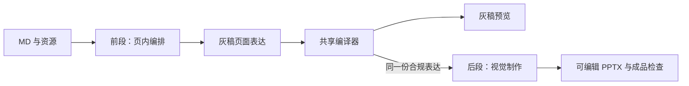

# 系统架构

本文维护流程、职责与资源；产品范围见[目标与路径](产品目标与路径.md)，选型结论与依据见[技术选型与决策](技术选型与决策.md)。库存沿用 10 月 30 日只读核查，既有生产链未重跑。

## 已确认的骨架

| 环节 | 责任 |
| --- | --- |
| MD → 灰稿 | 确定页内分组、主次、关系、阅读顺序和区域，绑定内容 |
| 共享编译器 | 检查引用、绑定、几何与交接完整性，生成灰稿预览和诊断 |
| 灰稿 → 成品 | 在既定区域选择结构图、放入图片、制作文字与图形，应用样式并检查 PPTX |

灰稿固定内容归属、整页位置和面积。文字区保留实文与层级；蓝区保留图示内容描述、关系与要求，**不选具体结构资产或绑定其内部槽位**。后段选择资产并完成区域内部制作，保持内容与关系；图片区域保留资源和放置要求。

结构化页面表达是交接源，预览是编译视图。两段读取同一份表达；后段不重新分页，也不从预览图识别布局。分支安排见[AGENTS](../AGENTS.md#分支分工)。

## 设计能力与检查

前段调用页面分区和图文组织能力，后段调用标题、文字、图像、结构图和图表的区域制作能力，共享 Skin、风格与运行基础。模型承担内容理解和受限判断，程序承担测量、几何、绑定、调用与编译；具体组合待定。

共享编译器检查元素和资源引用、内容绑定、区域边界及必要避让、文字层级和蓝区描述完整性。语义忠实与表达质量另行审查；后段检查结构匹配、实际原生对象和导出结果。编译器的具体检查深度待定。

正式建设时，两条线按同一规范推进，后段可先消费合规的模拟灰稿，再接入前段产物。

## 已有基础

| 入口 | 核查到的能力与限制 |
| --- | --- |
| [工作台 main](../src/workbench/main-flow.mjs) | 登记十步，仅原稿读取与规范化已接入；长稿分页、前置选结构等旧步骤需调整 |
| [灰稿 Agent](../src/runner/gray-agent.mjs) | 有语义计划、来源审查、布局测量选择、内容绑定与编译工具；须划清上下游职责 |
| [成品运行器](../src/runner/run.mjs)、[制作工具](../src/runner/tools/build-tools.mjs) | 可读灰稿并保留分区、调用结构与制作；当前交接仅支持零或一个图示区，部分文字仍由模型给几何 |
| [旧双导演](../src/agent/workflow.mjs)、[工具循环](../src/runner/loop.mjs)、[状态](../src/runner/state.mjs) | 两套调度并存；已有持久状态、参数校验、日志及 Chat/JEV 接入，保留哪些待定 |
| [灰稿候选](../src/runner/gray-layout-catalog.mjs)、[页面布局](../src/visual-runtime/page-layout-library.mjs)、[组合布局](../catalog/composition-layouts.json) | 七类灰稿程序覆盖并列、独立及部分主辅分带；另有 14 个静态组合布局，不能全部视为前段可用候选 |
| [灰稿编译](../src/runner/gray-draft.mjs)、[交接校验](../src/runner/gray-expressions.mjs)、[页面表达候选](../src/visual-runtime/page-expression-plan.mjs) | 多份内部表示并存，部分含具体结构 ID；需按蓝区职责统一 |
| [文字库](../src/visual-runtime/text-layout-library.mjs)、[文字程序](../src/render/gray-text-program.mjs)、[内容映射](../src/runner/visual-block-mapping.mjs) | 有两个 MD 排版候选、纯文字 `source-text-v1` 及受限分组合并能力，尚未形成统一制作通路 |
| [结构资产](../assets/结构图/)、[调用入口](../src/runtime/structure-skills.mjs) | 35 个结构 Skill 登记保留造型实现；32 个未验证、3 个样例候选 |
| [Skin](../src/runtime/skins/)、[规则](../rules/)、[来源处理](../src/content/)、[选择器](../src/selection/) | 有东北大学／中性风格、来源绑定及内容和排版规则；按实际消费点核对复用 |
| [PPT 引擎](../src/ppt-engine/)、[原生组件](../src/asset-runtime/)、[HTML 编译](../src/visual-runtime/html-component-runtime.mjs) | 有浏览器测量、原生构建与导出；当前引擎包许可限评估测试，产品引擎及独立部署待选 |

另有 93 份资产登记、其中 39 份标记 `core`；登记量不代表可交付能力。[测试](../tests/)、[实验](../experiments/)和 `outputs/` 保留局部证据。新 main 未接通与旧路径存在制作能力须分别判断。

## 本次重议的依据

[9 月 20 日样例](../experiments/home-mckinsey-style-20260920/README.md)以用户生图为视觉参照，在固定灰稿上经多轮规则和代码调整生成原生 PPTX；具体过程见[当时记录](方向讨论/20260920.md)。它说明局部可以复现，跨稿自动交付仍未证实。

此前枚举组件、调灰稿与看图修改消耗较大。此次需同时判断：组件怎样组成好的整页设计，调整是否进入实际制作能力，迭代能否带来可复用的改进。设计效果、建设成本和复用收益都影响路线选择。

## 尚待明确的架构

- 整页设计如何形成，页面版式与区域组件怎样组合；Skin、文字测量和组件容量何时参与编排。
- 内容关系、表达方式、候选筛选与选择分别交给哪些模型或程序，是否沿用现有调度和 JEV。
- 以哪份内部表示为底稿统一灰稿，哪些检查进入共享编译器。

围绕这些问题做必要探索，明确后再定实现范围，最后反推 MD 格式。[原生成线决策](archive/20261030重新讨论前/docs/工作流/正式生成/生成线架构决策.md)与[原页面规范](archive/20261030重新讨论前/docs/架构/页面构成与布局规范.md)仅作历史依据。
