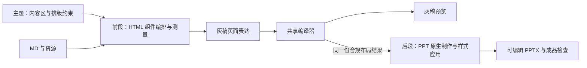

# 系统架构

本文维护现行架构分工与资源；产品范围见[目标与路径](产品目标与路径.md)，讨论期的技术取舍见[技术选型与决策](技术选型与决策.md)。下列分工于 2026-11-19 讨论确认，尚未在生产链接通；库存沿用 10 月 30 日只读核查。

## 已确认的骨架

| 环节 | 责任 |
| --- | --- |
| 主题约束 | 提供内容区宽高、位置及影响容量的字体、字号、行距等；灰稿不必复刻页壳 |
| MD → 灰稿 | 统一考虑实文、图片及结构组件，确定分组、主次、关系、阅读顺序、组件选择与内外布局，测量实际承载 |
| 共享编译器 | 检查来源、资源、组件与内容绑定、几何和交接完整性，生成灰稿预览与诊断 |
| 灰稿 → 成品 | 按布局结果制作原生文字、图形及媒体，应用主题页壳与样式，检查可编辑性和实际 PPT 渲染 |

## 灰稿与交接

灰稿是完成主要表达与空间设计的整页制作蓝图：显示真实文字、层级、选定组件及内部内容，排版尽量接近最终 PPT。可简化配色与装饰，但保留影响占位的文字尺度、组件几何和空间分配；不再以蓝区制作说明代替尚待后段设计的结构。

正文页的主旨句用主题页首提供的主旨角色，位于正文区上方。正文以讲述与听众理解为目标，保留必要结论、关系和限定，展开论述可由讲述稿承担。

交接源是结构化页面表达，预览是其可视检查视图。至少保留内容与来源、归属与关系、选定组件及版本和内容绑定、内外布局结果、字体与样式角色、媒体资源及放置方式。具体格式与字段待定，灰稿不预先限定为 PPTX 文件。

后段读取同一份布局结果，复用组件几何或其计算方法完成原生制作，不从截图反推位置，不另选表达或结构、重新分页或独立重排。原生实现问题修所属制作能力；确需改变内容、组件或布局时回写灰稿并重新编译。分支安排见[AGENTS](../AGENTS.md#分支分工)。

布局依赖内容区形状和排版条件，不仅是面积。主题变化影响内容区或文字占位时重算灰稿；HTML 测量与实际 PPT 换行、边界的差异须在成品中检查。

## 设计能力与检查

组件库提供文字、图文、流程图、结构图等可复用表达；调用时以真实内容、区域和排版约束测量容量，组件与整页布局共同调整。纳入制作的组件须核对 HTML 呈现与原生 PPT 实现的对应能力，共用设计边界与几何依据，不能以库登记或预览可用代替原生验证。

模型承担内容理解、表达及受约束组合的判断；程序承担测量、容量反馈、几何、绑定、编译与检查。模型组合、编码自由度与候选选择机制仍待定。

共享编译器检查引用、内容绑定、组件支持范围、文字层级、区域边界、必要避让及交接完整性；语义忠实与整页表达质量另行审查。后段检查内容保留、原生对象、文字换行、连接与实际导出。具体检查深度待定。

正式建设时，两条线按同一规范推进，后段可先消费合规的模拟灰稿，再接入前段产物。

## 已有基础

| 入口 | 核查到的能力与限制 |
| --- | --- |
| [工作台 main](../src/workbench/main-flow.mjs) | 登记十步，仅原稿读取与规范化已接入；新灰稿职责尚未接通，旧步骤按新分工复核 |
| [灰稿 Agent](../src/runner/gray-agent.mjs) | 有语义计划、来源审查、布局测量选择、内容绑定与编译工具；须划清上下游职责 |
| [成品运行器](../src/runner/run.mjs)、[制作工具](../src/runner/tools/build-tools.mjs) | 可读灰稿并保留分区、调用结构与制作；当前交接仅支持零或一个图示区，部分文字仍由模型给几何 |
| [旧双导演](../src/agent/workflow.mjs)、[工具循环](../src/runner/loop.mjs)、[状态](../src/runner/state.mjs) | 两套调度并存；已有持久状态、参数校验、日志及 Chat/JEV 接入，保留哪些待定 |
| [灰稿候选](../src/runner/gray-layout-catalog.mjs)、[页面布局](../src/visual-runtime/page-layout-library.mjs)、[组合布局](../catalog/composition-layouts.json) | 七类灰稿程序覆盖并列、独立及部分主辅分带；另有 14 个静态组合布局，不能全部视为前段可用候选 |
| [灰稿编译](../src/runner/gray-draft.mjs)、[交接校验](../src/runner/gray-expressions.mjs)、[页面表达候选](../src/visual-runtime/page-expression-plan.mjs) | 预留区、具体结构 ID 等多份表示并存，需统一为完成组件编排的交接表达 |
| [文字库](../src/visual-runtime/text-layout-library.mjs)、[文字程序](../src/render/gray-text-program.mjs)、[内容映射](../src/runner/visual-block-mapping.mjs) | 有两个 MD 排版候选、纯文字 `source-text-v1` 及受限分组合并能力，尚未形成统一制作通路 |
| [结构资产](../assets/结构图/)、[调用入口](../src/runtime/structure-skills.mjs) | 35 个结构 Skill 登记保留造型实现；32 个未验证、3 个样例候选 |
| [Skin](../src/runtime/skins/)、[规则](../rules/)、[来源处理](../src/content/)、[选择器](../src/selection/) | 有东北大学／中性风格、来源绑定及内容和排版规则；按实际消费点核对复用 |
| [PPT 引擎](../src/ppt-engine/)、[原生组件](../src/asset-runtime/)、[HTML 编译](../src/visual-runtime/html-component-runtime.mjs) | 有浏览器测量、原生构建与导出；当前引擎包许可限评估测试，产品引擎及独立部署待选 |

另有 93 份资产登记、其中 39 份标记 `core`；登记量不代表可交付能力。[测试](../tests/)、[实验](../experiments/)和 `outputs/` 保留局部证据。新 main 未接通与旧路径存在制作能力须分别判断。

## 本次重议的依据

[9 月 20 日样例](../experiments/home-mckinsey-style-20260920/README.md)以用户生图为视觉参照，在固定灰稿上经多轮规则和代码调整生成原生 PPTX；具体过程见[当时记录](方向讨论/20260920.md)。它说明局部可以复现，跨稿自动交付仍未证实。

此前枚举组件、调灰稿与看图修改消耗较大。此次需同时判断：组件怎样组成好的整页设计，调整是否进入实际制作能力，迭代能否带来可复用的改进。设计效果、建设成本和复用收益都影响路线选择。

## 尚待明确的架构

- 整页组合规则、可用变体与容量反馈怎样执行，怎样避免逐页补丁式调试。
- 内容理解、组件选择与布局组合分别交给哪些模型或程序，开放多少编码自由度。
- 以哪份内部表示统一灰稿，怎样向原生制作传递布局，如何处理测量差异与失败回写。

围绕这些问题做必要探索，明确后再定实现范围，最后反推 MD 格式。[原生成线决策](archive/20261030重新讨论前/docs/工作流/正式生成/生成线架构决策.md)与[原页面规范](archive/20261030重新讨论前/docs/架构/页面构成与布局规范.md)仅作历史依据。
